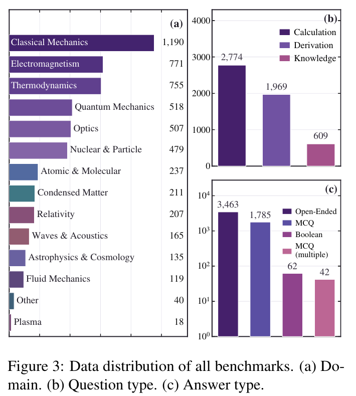
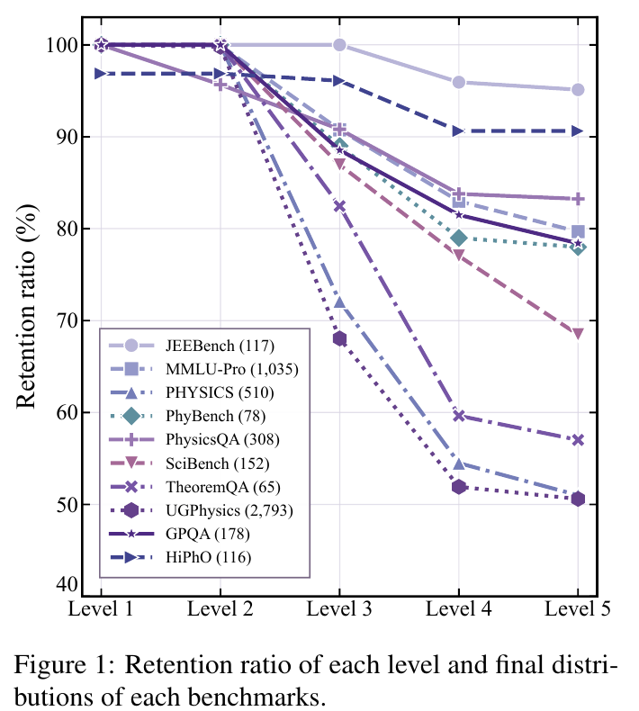
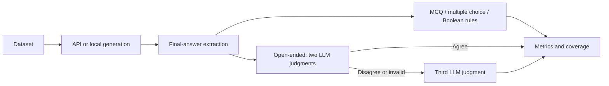

<div align="center">

# UniPhysics

### A Quality-controlled Unified Framework for Evaluating LLMs' Physical Reasoning Ability

**10 benchmarks · 5,352 curated questions · 3,751 removed samples · 4 answer formats**

[Quick start](#quick-start) · [Datasets](#datasets) · [Evaluation](#evaluation) · [中文说明](README.zh-CN.md)

</div>

UniPhysics brings physics reasoning benchmarks into one quality-controlled evaluation framework. It combines a unified data format, task-aware prompts, robust final-answer extraction, and hybrid rule/LLM judging. The accompanying study evaluates 21 language models and investigates how defective questions distort model comparisons.

This release contains the curated benchmark, the removed-data audit set, and the complete evaluation pipeline. Model weights, historical model outputs, and the original data-cleaning pipeline are not included.

## What is included

- **Curated data:** English, text-only questions covering 10 benchmark sources and 14 physics domains.
- **Removed data:** the original filtered-out samples, retained for auditing and clean-versus-removed comparisons.
- **Two generation backends:** local Hugging Face checkpoints through vLLM and OpenAI-compatible API endpoints.
- **Hybrid scoring:** deterministic MCQ, multiple-choice and Boolean checks; two independent LLM judgments for open-ended answers, followed by a third judgment when they disagree or fail.
- **Reproducible runs:** explicit configuration, incremental JSONL output, configuration-aware resume, and accuracy with coverage and failure counts.

<p align="center"></p>

*Figure 3 from the accompanying manuscript. The packaged clean set contains 3,463 open-ended, 1,785 single-choice, 62 Boolean, and 42 multiple-choice questions.*

## Quick start

The source evaluation environment is Conda **`swift`**, with **Python 3.12.0**, **PyTorch 2.6.0+cu124**, **vLLM 0.8.4**, and **Transformers 4.51.3**. [requirement.txt](requirement.txt) exports pinned evaluation dependencies from that environment. Local generation requires Linux x86_64 and an NVIDIA driver compatible with CUDA 12.4. Shell examples below use Bash; on Windows use the API-only installation and `python -m uniphysics ...` commands.

```bash
git clone https://github.com/Ruiqi327/UniPhysics.git
cd UniPhysics
conda create -n uniphysics python=3.12.0 pip -y
conda activate uniphysics
python -m pip install --upgrade pip
python -m pip install -r requirement.txt
python -m pip install --no-deps -e .
python -m pip check

# Validate the bundled data without contacting any API.
python -m uniphysics validate
python -m uniphysics validate --dataset Eval/benchmark/UniPhysics_deleted.jsonl
```

If you downloaded a source archive, extract it and start at `cd UniPhysics`. The repository URL is the address listed in the manuscript; packaging this release does not itself publish it there.

To use the existing environment, run `conda activate swift`, then `python -m pip install --no-deps -e .` from this repository. For **API-only** use without GPU dependencies, create a Python 3.10+ environment and run `python -m pip install -e .` instead of installing `requirement.txt`.

The requirements file pins nine evaluation/backend dependencies, while pip resolves their transitive dependencies. [docs/swift-environment.txt](docs/swift-environment.txt) contains the complete sanitized package inventory for auditing, including unrelated training tools; it is not a clean-install requirements file. See [environment notes](docs/ENVIRONMENT.md) for the three existing dependency conflicts and the excluded private editable MS-SWIFT checkout.

Credentials are read from `UNIPHYSICS_API_KEY` (or `OPENAI_API_KEY`). Set the endpoint through `UNIPHYSICS_BASE_URL`, `OPENAI_BASE_URL`, or `--base-url`. If unset, the OpenAI SDK uses its standard endpoint. Keep keys in your local environment, not in scripts or command-line arguments.

```bash
read -rsp "API key: " UNIPHYSICS_API_KEY; echo
export UNIPHYSICS_API_KEY
export UNIPHYSICS_BASE_URL="https://api.openai.com/v1"

# Substitute a model ID supported by your endpoint. Start with five questions.
bash Eval/run_api_eval.sh \
  --project_name api-smoke \
  --model YOUR_MODEL_ID \
  --limit 5
```

`.env.example` documents the available environment variables. The CLI does not automatically load `.env`; if you create one, load it explicitly with `set -a; source .env; set +a`.

## Datasets

Both JSONL files are included **byte-for-byte**, with SHA-256 checksums and statistics in [manifest.json](Eval/benchmark/manifest.json).

| File | Records | Purpose |
| --- | ---: | --- |
| [uniphysics.jsonl](Eval/benchmark/uniphysics.jsonl) | 5,352 | Main evaluation benchmark |
| [UniPhysics_deleted.jsonl](Eval/benchmark/UniPhysics_deleted.jsonl) | 3,751 | Removed/defective samples for auditing |

| Benchmark | Clean questions |
| --- | ---: |
| JEEBench | 117 |
| MMLU-Pro | 1,035 |
| GPQA | 178 |
| PhysicsQA | 308 |
| PHYSICS | 510 |
| UGPhysics | 2,793 |
| PhyBench | 78 |
| TheoremQA | 65 |
| SciBench | 152 |
| HiPhO | 116 |
| **Total** | **5,352** |

Each line is an object with `id`, `problem`, `answer`, `answer_type`, `domain`, and `question_type`. Question text includes options when applicable. `answer_type` is one of `MCQ`, `MCQ(multiple)`, `Boolean`, or `Open-Ended`. IDs retain their original source prefixes, including `MMLU_pro` and lowercase `gpqa`.

The removed set intentionally preserves unreliable labels and missing context. All 3,751 records are labeled `Open-Ended` in the supplied file; nine have empty gold answers. Four IDs use `NBPhO_` or `PanPhO_` prefixes. `--benchmark all` includes every record, and empty gold answers are explicitly marked `missing_gold` during judging. Do not merge this set into the clean benchmark. See the [data card](docs/DATASET.md) for details and [data licensing notes](DATA_LICENSE.md) for upstream attribution.

<p align="center"></p>

*Figure 1 from the manuscript. Curation comprises data unification, n-gram deduplication, question verification, answer verification, and final review/annotation.*

## Evaluation

### 1. Generate answers through an API

```bash
bash Eval/run_api_eval.sh \
  --project_name api-full \
  --model YOUR_MODEL_ID \
  --benchmark all \
  --max_tokens 16384 \
  --num-workers 8
```

Sampling parameters are omitted by default for API requests so that models which reject `temperature` or `top_p` can use their provider defaults. To set them explicitly, add `--temperature 0.1 --top_p 0.95`. Unlike the original experimental scripts, this release actually forwards these flags to the API. `--max-retries 4` means at most five attempts per request; authentication and other permanent client errors fail without repeated retries. Empty responses and malformed judge tags are retried.

### 2. Or generate locally with vLLM

The quick-start `requirement.txt` installation includes the source environment's local backend. Consult [vLLM installation guidance](https://docs.vllm.ai/en/latest/getting_started/installation/) if your CUDA stack requires a different build; changing backend versions can change reproducibility.

```bash
# Activate the environment installed above (or: conda activate swift).
conda activate uniphysics
bash Eval/run_local_eval.sh \
  --project_name qwen3-4b \
  --model-path Qwen/Qwen3-4B \
  --gpus 0 \
  --batch_size 8 \
  --temperature 0.7 --top_p 0.8 --top_k 20 \
  --max_tokens 16384 \
  --enable_thinking true
```

`--model-path` accepts a Hugging Face model ID or your own model directory. Weights download on first use when a model ID is given. `--gpus 0,1` runs **one full model replica per GPU**, splitting examples between replicas; it does not provide tensor parallelism. Each model must fit on one selected GPU. Context length must accommodate both the question and output budget. `--max_model_len`, when supplied, must exceed `--max_tokens`.

`--presence-penalty`, `--repetition-penalty`, and `--seed` are available for local runs. `--trust_remote_code` is opt-in. The thinking switch is applied to Qwen3+ models using the tokenizer chat template locally and a trailing `/think` or `/no_think` in API prompts; other model families ignore this switch, and some provider/checkpoint implementations may not honor it.

### 3. Judge generated answers

```bash
bash Eval/judge.sh \
  --project_name api-full \
  --model_1 FIRST_JUDGE_ID \
  --model_2 SECOND_JUDGE_ID \
  --model_3 ARBITER_ID \
  --max_tokens 8192 \
  --num-workers 8
```

Use the same `--project_name` and `--output-dir` as generation. All three models must be available through the configured endpoint. The first two may use the same model ID: they still make independent requests. A run containing only closed-form answers needs no judge model IDs or API credentials.

The manuscript reports DeepSeek-v4-flash for the first two independent judgments and DeepSeek-v4-pro for final arbitration. Supply those IDs only if your provider supports them. The release does not force a vendor or assume access to a particular model.



Answer extraction supports balanced nested `\boxed{...}`, `<answer>`, `Final answer:`, and `****` formats, then falls back to the final 300 characters. This preserves the supplied evaluation code's fallback; the manuscript describes 200 tokens, so the two are not identical. See [reproducibility notes](docs/REPRODUCIBILITY.md) for other implementation differences.

### Filtering, output locations, and resume

- `--benchmark MMLU-Pro,GPQA` selects sources; matching ignores case and punctuation.
- `--test_mode mini` selects the first 500 questions **per source**, preserving file order. It is not a random sample or a separate mini dataset.
- `--limit N` truncates the selected set for smoke testing. Use a new project name for a subsequent full run.
- `--dataset Eval/benchmark/UniPhysics_deleted.jsonl` evaluates the removed set separately.
- `--output-dir results` is relative to your current working directory; the bundled default dataset is located relative to the installed package. The Shell wrappers work when invoked from another directory.
- `--resume` reuses successful matching results and retries failed records. Generation refuses changed data, code, or configuration. Judge stages are checked against the full prompt, model, sampling settings, endpoint, and code, so changed answers/models invalidate the affected cache.

Never run two processes against the same project directory. A `.run.lock` prevents concurrent writes. After a forcibly killed process, confirm it has stopped before removing its stale lock. A malformed interrupted JSONL cache is safely regenerated.

### Results

```text
results/<project_name>/
├── data.jsonl           # Selected dataset
├── run.json             # Generation settings and hashes; no credentials
├── response.jsonl       # Original fields, response, extracted answer and status
├── judge_model_1.jsonl  # Incremental first-stage judgments
├── judge_model_2.jsonl  # Incremental independent second judgments
├── judge_model_3.jsonl  # Arbitration requests only
├── judge_config.json    # Judge configuration and input fingerprint
├── judge.jsonl          # Final decisions, methods and failure statuses
├── metrics.json         # Machine-readable metrics
└── metric.txt           # Human-readable report
```

Reports include micro accuracy, macro accuracy over benchmark sources with resolved judgments, domain/question/answer-type breakdowns, coverage, API errors, generation failures, and missing gold answers. **Accuracy = correct / judged**; unresolved records are excluded. Coverage is `judged / total`, and `accuracy_over_all = correct / total` is also supplied. Always report coverage alongside accuracy, especially for removed-set experiments. Generation or judge API failures result in exit status 1; invalid arguments/configuration result in status 2.

```bash
python -m uniphysics metrics --input results/api-full/judge.jsonl
```

## Development and layout

```text
Eval/                 Compatibility Python and Bash entry points
  benchmark/          Two supplied JSONL datasets and checksum manifest
uniphysics/           CLI, data, API/local backends, orchestration, rules, metrics
docs/                 Data card, reproducibility notes, manuscript figure crops
tests/                Offline regression and HTTP integration tests
tools/                Release checks for checksums, credentials and private paths
```

```bash
python -m pip install -e '.[dev]'
python -m pytest -q
python tools/check_release.py
python -m build
```

Tests use a local simulated API and mocked local generation. They require no real API key or GPU. A full real-model run remains dependent on the chosen provider, model access, CUDA stack and available GPU memory.

## Citation and attribution

```bibtex
@misc{zhou2026uniphysics,
  title  = {UniPhysics: A Quality-controlled Unified Framework for Evaluating LLMs' Physical Reasoning Ability},
  author = {Ruiqi Zhou and Yudong Li and Xintian Li and Xinyi Liu and Ruyi Gai and Jiancheng Ding and Yongfeng Huang},
  year   = {2026},
  note   = {Manuscript},
  url    = {https://github.com/Ruiqi327/UniPhysics}
}
```

Please also credit the original benchmark creators listed in [DATA_LICENSE.md](DATA_LICENSE.md). The code is licensed under [MIT](LICENSE). That license does not relicense third-party benchmark questions, answers, or manuscript figures.
